<picture>
  <source media="(prefers-color-scheme: dark)" srcset="banner-dark.svg">
  
</picture>

I build backend services with **Java and Spring Boot** and Android apps with **Kotlin and Jetpack Compose**. I'm a final-year Computer Engineering student at Çanakkale Onsekiz Mart University, graduating in June 2027, with internships in fintech backend and Android development.

**Open to remote part-time and contract work now, and full-time roles from July 2027.** I'm based in Türkiye (UTC+3), so my working hours overlap with most of Europe's.

### FinOra: personal finance, from API to app

<!-- Add a screenshot or a short GIF of the Android app here, for example:

-->

I built FinOra end to end: a Spring Boot API and the native Android app that uses it.

- Take a photo of a receipt and the backend reads the merchant, total, date, currency and category with Gemini Vision.
- Track budgets, categories and transactions, with a statistics dashboard and AI-generated spending insights.
- Insights are cached in Redis, refreshed when your data changes, and rate-limited per user.
- Backend: Java 21, Spring Boot, Spring Security with JWT, PostgreSQL with Flyway migrations, Docker Compose.
- Android: Kotlin, Jetpack Compose, MVVM, Hilt, Retrofit, Navigation Compose.

Code and setup: [ArdaArslann/FinOra](https://github.com/ArdaArslann/FinOra)

### Experience

**Backend Development Intern, Turkcell-Paycell** (Jan – Feb 2026)\
Java and Spring Boot on an internal operations tool. I made it possible to submit multiple payment configuration parameters in one request instead of entering and approving them one by one, and added endpoints to list and invalidate caches.

**Mobile Developer, TÜBİTAK 2247-C research project** (Jan – Jul 2025)\
A Kotlin app for recording clinical lung sounds, with spectrogram visualization and data labeling.

**Mobile Application Development Intern, EasyFlex Technology** (Aug 2025)\
A smart greenhouse app with real-time sensor dashboards and remote irrigation, ventilation and lighting controls.

### Tools

**Backend:** Java, Spring Boot, Spring Security, JPA, PostgreSQL, Redis, Flyway, Docker\
**Android:** Kotlin, Jetpack Compose, MVVM, Hilt, Retrofit, Room, DataStore\
**Also:** Git, React and TypeScript (basic)

### Contact

Email me at [arda.arslan3947@gmail.com](mailto:arda.arslan3947@gmail.com) or message me on [LinkedIn](https://www.linkedin.com/in/ardaarslann).
